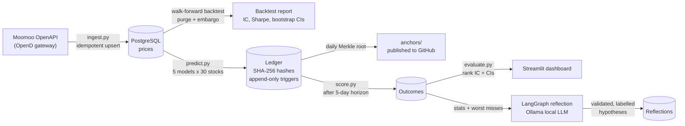

# 📈 Quant Agent

**A stock-ranking agent with a tamper-evident track record: market-data ingest → walk-forward backtest → hash-committed daily predictions → scoring and monitoring → guarded local-LLM reflection.**

A small forecasting system that ranks 30 liquid US stocks by expected 5-day return. Prices come from the Moomoo OpenAPI into PostgreSQL. Five models (a random baseline, momentum, ridge, LightGBM and an ensemble) are validated with a leakage-safe walk-forward backtest. Every live prediction is hashed and written to an append-only ledger before its outcome exists, then scored and monitored. A local LLM writes a weekly note, but only when there is enough data, and code checks its numbers. The project places no orders and uses no trading credentials. Educational project, not investment advice.

---

## Demo

**Dashboard**

   
  <b>Figure 1.</b> Dashboard (Streamlit)

- **Ledger:** predictions logged and scored, hash-mismatch count, recent daily anchors
- **Live skill:** rank IC per model with 95% confidence intervals and a rolling-window slider, with an "insufficient sample" warning until enough days are scored
- **Backtest:** results table and equity curves for all models against buy-and-hold

**Demo video** (silent, about 3 minutes): [link]

The recording shows the daily job logging 5 models × 30 stocks with an anchor hash, the fingerprint check (0 mismatches), the database refusing an edit, a delete and a truncate, the AI note declining to analyse thin data, the automated tests, and then the dashboard.

---

## Architecture

---

## Tech stack

| Area | Technologies |
|---|---|
| Language | Python, SQL (PL/pgSQL), PowerShell |
| Data and database | PostgreSQL 16, psycopg 3, SQLAlchemy 2, JSONB, pandas, NumPy, SciPy |
| Machine learning | scikit-learn (Ridge), LightGBM |
| Market data | Moomoo OpenAPI (OpenD gateway) |
| LLM and agents | Ollama (local LLM), Qwen2.5, LangGraph |
| Dashboard | Streamlit |
| DevOps | Docker, Docker Compose, Windows Task Scheduler, Git and GitHub |
| Testing | pytest |
| Config | YAML, python-dotenv |

---

## Concepts applied

**Data engineering**
- ETL from a broker API into PostgreSQL
- Idempotent upserts that are safe to re-run, with gap checks on loaded data
- Config-driven design: every assumption lives in one YAML file
- Scheduled daily batch job

**Modelling and validation**
- Cross-sectional ranking: predict which stocks beat the others, not absolute prices
- Walk-forward validation with purging and an embargo, to prevent label leakage
- Leakage tests, including a shuffled-label placebo
- Momentum and random baselines as sanity checks
- Next-open fills and transaction costs charged on turnover
- Rank IC (Spearman), net Sharpe and max drawdown against equal-weight buy-and-hold
- Block-bootstrap confidence intervals for autocorrelated samples

**Integrity and monitoring**
- Append-only ledger enforced with database triggers
- SHA-256 commitment per prediction and a daily Merkle root published outside the database
- Ex-ante logging: refuses stale or partial price bars
- Outcomes scored only after the horizon expires, with a model-version registry
- Rolling IC with minimum-sample gating

**LLM engineering**
- Stateful agent workflow with conditional edges (LangGraph)
- Deterministic output validation: rejects invented numbers, dates, advice and forecasts
- Sample-size gate and fallback to plain facts
- Local, private inference

**Software engineering**
- 34 tests covering leakage, costs, ledger hashing, metrics and LLM guardrails
- Pure-function design with an injected LLM, so the logic is testable offline

---

## Results

- Walk-forward backtest on 30 US large caps, about 3 years out-of-sample, net of costs: **no model showed a detectable edge**. Momentum had the highest rank IC (0.040, 95% CI [0.0002, 0.081]), and every excess-return interval against buy-and-hold spanned zero.
- A random model earned about the same as the benchmark, which shows how much of the return is the market itself.
- Limitations: the universe is today's large caps (survivorship bias), samples are small, and live scoring needs roughly 60 scored days before it means anything.

---

## Data
Daily bars for 30 US large caps (1,506 trading days each, Nov 2020 to Nov 2026, forward-adjusted), pulled from the Moomoo OpenAPI. Market data is not redistributed in this repository. A synthetic generator is included for offline tests.
